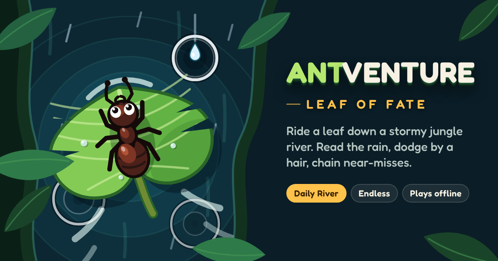
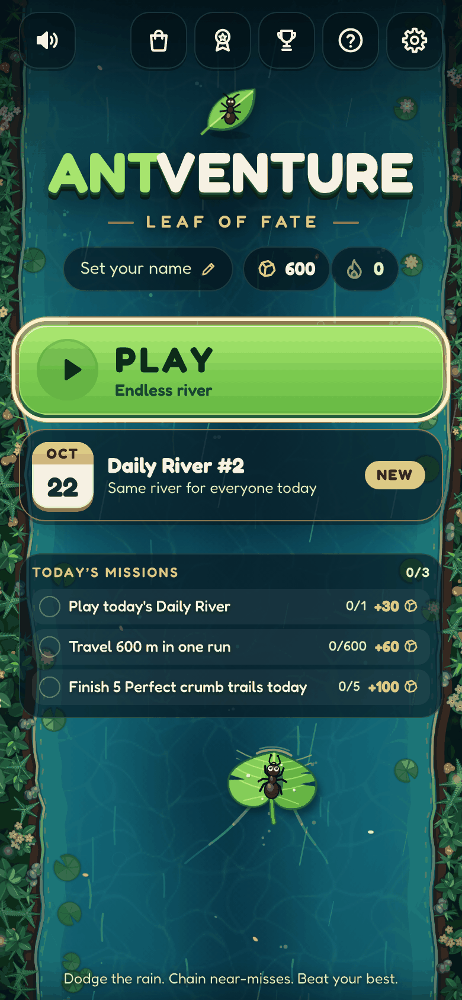
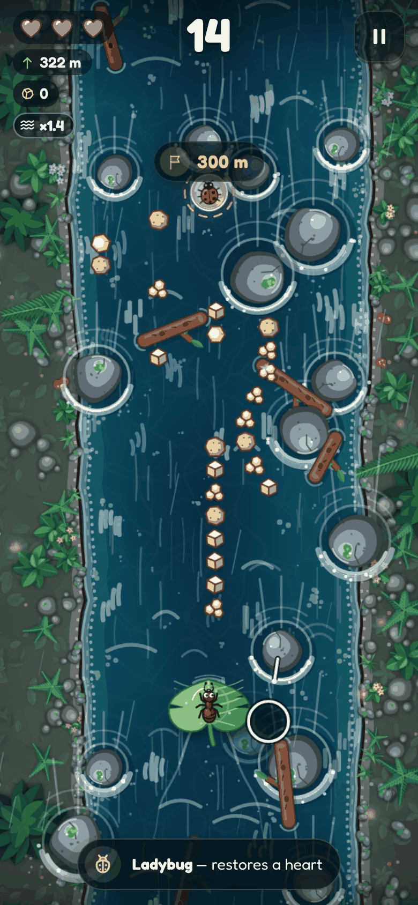
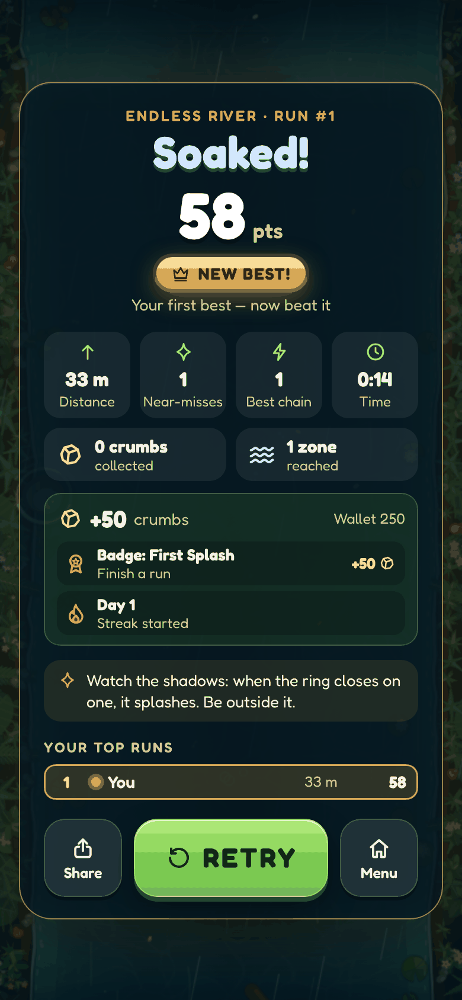

# Antventure: Leaf of Fate

[](https://github.com/reddy5310/antventure-final-pwa/actions/workflows/ci.yml)
[](https://github.com/reddy5310/antventure-final-pwa/actions/workflows/static.yml)



A tiny ant, one leaf, and a jungle river in a thunderstorm. Raindrops show you
where they'll land before they hit, so you read the storm, slip through the
gaps, and dodge by a hair to build your combo. You get three hearts, every
run is a fresh river, and there's one shared **Daily River** each day for
everyone to compete on.

**[Play now →](https://reddy5310.github.io/antventure-final-pwa/)** It's free,
runs in the browser, installs as an app and plays offline.

> This is **v2**, a full rebuild in TypeScript with a fixed-timestep engine,
> all art drawn in code, and competitive modes. The original v1 (single
> `index.html`) lives in git history: `git checkout 755dfea`.

---

## Screenshots

<!--
  Drop captures into docs/screenshots/ and uncomment the table below.
  Suggested: 1170x2532 phone captures (title, run, game over) and one desktop shot.

| Title | Run | Game over | Daily share |
| :---: | :---: | :---: | :---: |
|  |  |  |  |
-->

_Coming soon. Screenshots will live in `docs/screenshots/`._

## Features

- **Telegraphed rain.** A shadow and a closing ring mark every drop's
  landing spot, and the ring meets the edge at the moment of impact. Each hit
  is readable in advance, so a hit is on you, not on luck.
- **Near-miss combos.** Clear a splash by a hair to score bonus points and
  grow your multiplier up to **x5**.
- **A storm that builds.** The storm moves from calm to drizzle, then
  downpour, then cloudburst. Rocks, drifting twigs, a narrowing river and
  faster rain ramp the difficulty over about three minutes.
- **Competitive loop.** A flag on the river marks your personal best. You
  get local top-10 boards, your rank on the game-over screen, and instant
  retry with one key or tap.
- **Daily River.** The same seeded river for everyone today ("Daily River
  #N"), with its own board, attempt counter and a share card.
- **Every input.** Play with touch (drag anywhere, so your thumb never covers
  the ant), mouse, keyboard or gamepad, with hotkeys for everything.
- **Fair and smooth.** A 120 Hz fixed-step simulation keeps runs identical on
  every device and frame rate. Hazards are fair by construction: there is
  always an escape.
- **All art in code.** A Canvas 2D world and SVG/CSS UI in one "cozy
  jungle storm" style. The game itself uses no image files.
- **Accessible.** Supports reduced motion, and telegraphs read by brightness
  and shape rather than colour alone. It has haptics, separate music and
  effects volumes, and adjustable touch sensitivity.
- **Installable PWA.** It works offline after the first visit. Updates
  arrive with an "Update" prompt and never reload mid-run.

## Controls

|  | Steer | Start / confirm | Pause / resume | Retry | Mute |
| --- | --- | --- | --- | --- | --- |
| **Touch** | Drag anywhere (relative, like a trackpad) | Tap **Play** | ⏸ button | **Retry** button | 🔊 button |
| **Mouse** | Leaf follows the cursor | Click | ⏸ button | **Retry** button | 🔊 button |
| **Keyboard** | `←` `→` or `A` `D` | `Space` / `Enter` | `Esc` / `P` | `R` | `M` |
| **Gamepad** | Left stick / D-pad | `A` | `Start` (`B` backs out) | `Y` | `Select` |

`R` restarts instantly at any point in a run, and from the game-over screen.
Outside a run, `P` / `Start` work as a "go" button: they start a run from the
title and retry from the game-over screen. `Esc` / `B` step back (close a
dialog, pause, or leave the game-over screen for the title). A run that has
already ended is saved even if you retry during the sinking animation.
Banks are soft walls: bumping them doesn't cost a heart.

Installed app: long-press the icon for a **Daily River** shortcut, which opens
`./?mode=daily` and drops you straight into today's river.

## Modes

| Mode | River | Leaderboard |
| --- | --- | --- |
| **Endless** | A new random river every run. | Your top 10 on this device. |
| **Daily River** | One seeded river shared by everyone, renewed at local midnight. | Today's top 10 and your attempt count, plus a share card. |

## Scoring

```
score = metres × multiplier  +  near-miss bonuses
```

- **Distance:** 1 point per metre (50 world units = 1 m), times your current multiplier.
- **Near-miss:** a splash that lands just outside the ant scores **+25 × multiplier** and adds 1 to the combo.
- **Multiplier:** x1, plus 0.25 per combo step, capped at **x5**. The combo fades after 3.5 s without a near-miss, and any hit breaks it.
- **Hearts:** you have 3. A splash, rock or twig costs one, then you get 1.6 s of invulnerability. Lose the last one and the run ends.
- **Milestones:** a cue every 100 m, and a fanfare when you pass your personal-best flag.

## Install as an app

- **Android (Chrome):** use the install button on the title screen, or open ⋮ and choose **Install app**.
- **iPhone / iPad (Safari):** tap Share, then **Add to Home Screen**.
- **Desktop (Chrome / Edge):** click the install icon in the address bar.

After the first load the game works fully offline: the app shell, music,
fonts and icons are all precached.

## Development

Requires Node **20.19+** (CI uses 22).

```bash
npm ci
npm run dev            # dev server with hot reload: http://localhost:5173
npm run check          # type-check + unit tests (Vitest) + production build
npx playwright install chromium   # once, for the e2e tests
npm run test:e2e       # Playwright, phone + desktop Chromium, against the production build
npm run icons          # regenerate icons + social card from scripts/icon-art.mjs
```

The scripts in more detail:

- `npm run preview` serves the last production build on http://localhost:4173.
- `npm run test:e2e:ui` opens Playwright's UI mode.
- In the browser console, `window.__ant` exposes `{ world, scene, settings, play(mode), pause(), resume(), menu(), storage }` for debugging. The e2e tests use it too.

## Project structure

```
├── index.html               # Shell: meta/social tags, boot background, #game canvas + #ui root
├── src/
│   ├── main.ts              # Orchestration: scenes (menu → run ⇄ paused → over), event dispatch
│   ├── types.ts, config.ts  # Shared contracts and cross-module constants
│   ├── storage.ts           # Settings, names, local leaderboards, stats (safe localStorage)
│   ├── engine/              # Fixed-timestep loop, viewport mapping, input, seeded RNG, haptics
│   ├── game/                # Simulation: river, drops, obstacles, player, scoring, storm, fairness
│   ├── render/              # Canvas 2D renderer: water, banks, foliage, leaf, ant, effects, weather
│   ├── ui/                  # DOM/SVG UI: title, HUD, pause, game over, modals, share card
│   └── audio/               # Web Audio mixer: music, rain ambience, synthesized SFX
├── public/
│   ├── audio/               # bgm.mp3, rain.mp3
│   ├── icons/               # PWA icons + favicons (generated)
│   └── og-image.png         # Social card (generated)
├── scripts/                 # make-icons.mjs (Playwright rasteriser), icon-art.mjs (vector art), png.mjs
├── tests/
│   ├── unit/                # Vitest: simulation, fairness, difficulty, input
│   └── e2e/                 # Playwright: boot, run loop, controls, offline
└── .github/workflows/       # ci.yml (checks), static.yml (GitHub Pages deploy)
```

## Deployment

Every push to `main` runs `.github/workflows/static.yml`. It installs with
`npm ci`, runs the unit tests and `npm run build`, then publishes `dist/` to
**GitHub Pages**. In the repository settings, go to **Pages** and set
**Source** to **GitHub Actions**. Pull requests run `.github/workflows/ci.yml`,
which covers type-check, unit tests, build and the Playwright suite.

The build uses a relative base, so `dist/` works from any path or static host.
Set `SITE_URL` at build time to make the social-card URLs absolute; the
Pages workflow does this for you.

Players coming from v1 are moved over automatically. `public/service-worker.js`
replaces the old cache-first worker, clears its cache and reloads into v2.

## Roadmap

- **Phase 2:** collectibles, power-ups, river zones with their own
  mechanics, and a night river.
- **Phase 3:** missions, skins and achievements.

Leaderboards are local for now. Global boards need a server that validates
runs, so v1's open-write database setup was retired instead of carried over.

## Credits

- **Developed by Satya**, mnvdsreddy93@gmail.com
- Typeface: [Fredoka](https://fonts.google.com/specimen/Fredoka) (SIL Open Font License), via Fontsource.
- Music and rain loops carried over from v1.

## License

[MIT](LICENSE) © 2025 Satya
